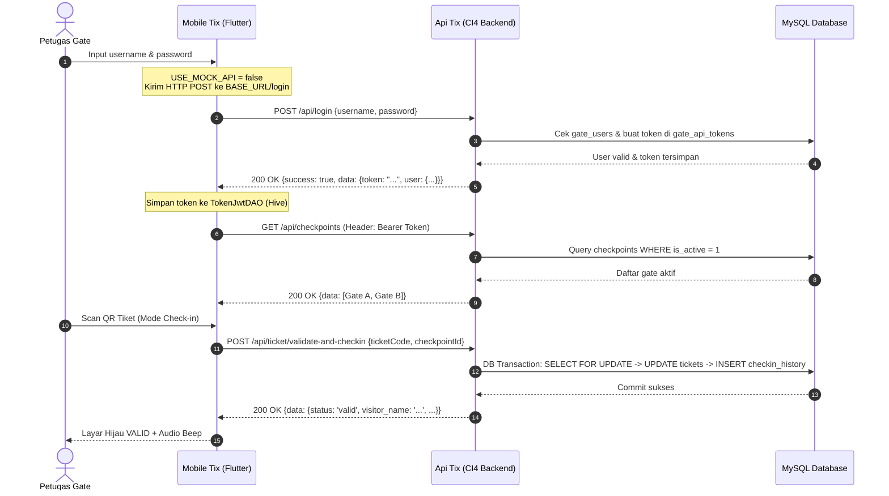

# Rencana Integrasi: Menghubungkan Mobile-Tix (Flutter) ke Api-Tix (CodeIgniter 4)

Dokumen ini memetakan hasil audit menyeluruh pada folder `mobile-tix` dan `api-tix`, serta memberikan rencana teknis terstruktur langkah demi langkah untuk menghubungkan aplikasi mobile validator ke backend REST API.

---

## 1. Ringkasan Audit Codebase Saat Ini

### A. Kondisi di `mobile-tix` (Flutter)
1. **Status Arsitektur**:
   - Seluruh layer Clean Architecture (BLoC/Cubit, Repository, DAO Hive, Dio Client, EasyLocalization) sudah lengkap dibangun (Fase 0–8 tuntas).
2. **Kondisi Network & API**:
   - **Mock Mode Aktif**: `EnvConfig.useMockApi` bernilai `true` secara default. Saat ini Dio dicegat oleh `MockApiAdapter` di layer interceptor (`api_service.dart`), sehingga request tidak pernah diteruskan ke jaringan internet/server riil.
   - **Payload Encryption Aktif**: `EnvConfig.isNeedEncrypt` bernilai `true` secara default. Body request dibungkus menjadi `{"encrypted": "<base64_iv_ciphertext>"}` menggunakan AES-CBC 256-bit dan response diharapkan dalam format `{"encrypted": "..."}`.
   - **HMAC Request Signature**: Mengirim header `X-SIGNATURE` (`METHOD|ENDPOINT|[TOKEN]|HASHED_BODY|TIMESTAMP`), `CHANNEL-CD`, dan `X-TIMESTAMP`.
   - **Typo Konfigurasi URL**: Di file `.env.example`, `BASE_URL=http://localhost:8081/api/login`. Nilai ini keliru karena `baseUrl` seharusnya hanya basis root API (contoh: `http://10.0.2.2:8080/api`), sebab kode repository memanggil endpoint seperti `post('/login')` atau `get('/checkpoints')`.
   - **Izin Android**: `AndroidManifest.xml` (main) belum memiliki `<uses-permission android:name="android.permission.INTERNET"/>` dan `android:usesCleartextTraffic="true"` untuk dev HTTP.

### B. Kondisi di `api-tix` (CodeIgniter 4)
1. **Status Endpoint (Fase 4 PRD)**:
   - Baru memiliki **7 dari 8 endpoint** yang diimplementasikan:
     - `POST /api/login` (`AuthController::login`)
     - `POST /api/logout` (`AuthController::logout`)
     - `GET /api/me`
     - `GET /api/checkpoints`
     - `POST /api/ticket/check`
     - `POST /api/ticket/validate-and-checkin`
     - `GET /api/dashboard/summary`
   - **1 endpoint inti lainnya belum dibuat**:
     - `GET /api/ticket/history`
2. **Format Data & Keamanan Backend**:
   - Backend saat ini mengharapkan dan mengembalikan **Plain JSON murni** (`{"username": "...", "password": "..."}`), belum memiliki middleware untuk membuka enkripsi AES-CBC atau validasi header `X-SIGNATURE`.
   - `api-tix/app/Config/Filters.php` mengaktifkan `forcehttps` secara default dalam `$required['before']`, yang akan menolak atau me-redirect request HTTP biasa saat pengujian lokal (`php spark serve`).
   - Token autentikasi yang dihasilkan berupa 64-karakter hex (256-bit opaque token) dengan hash SHA-256 yang tersimpan di tabel `gate_api_tokens`. Validasi dilakukan oleh `ApiAuthFilter`.
3. **Database & Model**:
   - Tabel database dan migrasi utama saat ini berada di project `web-tix` (12 tabel: `gate_users`, `gate_api_tokens`, `checkpoints`, `tickets`, `ticket_details`, `checkin_history`, dll.).
   - `api-tix/app/Models` baru memiliki `GateUserModel` dan `GateApiTokenModel`. Model lain seperti `CheckpointModel`, `TicketModel`, dan `CheckinHistoryModel` perlu disinkronkan dari `web-tix`.

---

## 2. User Review Required

> [!IMPORTANT]
> **Keputusan Format Enkripsi Payload (Pilih Opsi A atau Opsi B):**
> 
> * **Opsi A (Direkomendasikan untuk Integrasi Praktis & Cepat)**:
>   - Gunakan format **Standard Plain JSON** antara Mobile dan Backend.
>   - Di `mobile-tix`: Ubah setting konfigurasi `IS_NEED_ENCRYPT=false`. Komunikasi tetap aman menggunakan protokol HTTPS dan Bearer Token.
>   - Keuntungan: Sangat mudah didebug, transparan di log Dio dan Postman, tidak rentan terhadap ketidakcocokan pustaka kriptografi PHP vs Dart.
> 
> * **Opsi B (Enterprise Full Payload Encryption)**:
>   - Pertahankan `IS_NEED_ENCRYPT=true` di `mobile-tix`.
>   - Di `api-tix`: Buat CI4 Filter/Middleware khusus (`ApiEncryptionFilter` dan `ApiSignatureFilter`) yang mendekripsi payload request sebelum masuk ke Controller, memverifikasi `X-SIGNATURE`, dan mengenkripsi ulang output response.
>   - Keuntungan: Payload body terenkripsi ganda di level aplikasi.

---

## 3. Open Questions

> [!WARNING]
> 1. **Perangkat Uji Mobile**: Apakah Anda akan menjalankan aplikasi Flutter di **Android Emulator**, **Perangkat Fisik Android (via USB/Wi-Fi)**, atau **Chrome/Web**?
>    - *Emulator Android* membutuhkan IP `http://10.0.2.2:8080/api` (karena `localhost` di emulator merujuk ke emulator itu sendiri).
>    - *Perangkat Fisik* membutuhkan IP LAN laptop Anda, misal `http://192.168.1.xxx:8080/api` (dalam satu jaringan Wi-Fi).
> 2. **Pilihan Opsi Enkripsi**: Apakah menyetujui menggunakan **Opsi A** (Plain JSON dev) terlebih dahulu untuk memastikan koneksi dan 8 endpoint berfungsi sempurna?

---

## 4. Alur Kerja Menghubungkan Mobile ke API



---

## 5. Rencana Perubahan Detail (Proposed Changes)

### Komponen A: Konfigurasi Jaringan & Environment di `mobile-tix`

#### [MODIFY] [env_config.dart](file:///d:/laragon/www/nextix/mobile-tix/lib/core/config/env_config.dart)
- Mengubah default `useMockApi` menjadi `false` (atau konfigurasi melalui `.env`).
- Memperbaiki default `baseUrl` ke format endpoint API yang benar:
  ```dart
  static const String baseUrl = String.fromEnvironment(
    'BASE_URL',
    defaultValue: 'http://10.0.2.2:8080/api', // Untuk emulator Android
  );
  ```

#### [MODIFY] [.env.example](file:///d:/laragon/www/nextix/mobile-tix/.env.example) & Buat `.env`
- Memperbaiki format base URL:
  ```env
  BASE_URL=http://10.0.2.2:8080/api
  API_TIMEOUT=30000
  USE_MOCK_API=false
  IS_NEED_ENCRYPT=false
  ```

#### [MODIFY] [AndroidManifest.xml](file:///d:/laragon/www/nextix/mobile-tix/android/app/src/main/AndroidManifest.xml)
- Tambahkan izin internet dan izin cleartext HTTP untuk development lokal:
  ```xml
  <uses-permission android:name="android.permission.INTERNET"/>
  <application
      android:label="mobile_tix"
      android:name="${applicationName}"
      android:icon="@mipmap/ic_launcher"
      android:usesCleartextTraffic="true">
  ```

---

### Komponen B: Konfigurasi & Persiapan Server `api-tix`

#### [MODIFY] [Filters.php](file:///d:/laragon/www/nextix/api-tix/app/Config/Filters.php)
- Menonaktifkan `forcehttps` pada mode development agar request HTTP lokal tidak dipaksa ke HTTPS yang belum terpasang sertifikat SSL.
- Mengaktifkan filter `cors` jika pengujian dilakukan melalui browser/web.

#### [NEW] [api-tix/.env](file:///d:/laragon/www/nextix/api-tix/.env)
- Mengonfigurasi kredensial database MySQL lokal (hostname `localhost`, database yang sama dengan `web-tix`, user `root`, password disesuaikan).
- Mengatur zona waktu aplikasi ke `Asia/Makassar` (WITA) sesuai PRD 2.2.

---

### Komponen C: Kelengkapan Model & Service di `api-tix`

#### [NEW] Salin Model dari `web-tix` ke `api-tix/app/Models/`:
- `CheckpointModel.php` (tabel `checkpoints`)
- `TicketModel.php` (tabel `tickets`)
- `TicketDetailModel.php` (tabel `ticket_details`)
- `CheckinHistoryModel.php` (tabel `checkin_history`)
- `CustomerModel.php` (tabel `customers`)

#### [NEW] [api-tix/app/Services/TicketValidationService.php](file:///d:/laragon/www/nextix/api-tix/app/Services/)
- Menangani validasi atomik sesuai PRD 9.1:
  - `checkTicket(string $ticketCode, int $checkpointId)`: Baca status tanpa mengubah status tiket (Mode Cek).
  - `validateAndCheckIn(string $ticketCode, int $checkpointId, int $gateUserId)`: Menggunakan transaksi DB `SELECT ... FOR UPDATE`, verifikasi status (`NOT_FOUND` → `CANCELLED` → `ALREADY_USED` → `EXPIRED` → `NOT_YET_VALID` → `VALID`), update tiket menjadi `used`, dan mencatat ke `checkin_history`.

---

### Komponen D: Implementasi 6 Controller & Route di `api-tix`

#### [MODIFY] [Routes.php](file:///d:/laragon/www/nextix/api-tix/app/Config/Routes.php)
Mendaftarkan seluruh 8 route REST API:
```php
$routes->group('api', ['namespace' => 'App\Controllers\Api'], static function ($routes) {
    // Publik
    $routes->post('login', 'AuthController::login');

    // Memerlukan token (api-auth)
    $routes->group('', ['filter' => 'api-auth'], static function ($routes) {
        $routes->post('logout', 'AuthController::logout');
        $routes->get('me', 'AuthController::me');
        $routes->get('checkpoints', 'CheckpointController::index');
        $routes->post('ticket/check', 'TicketController::check');
        $routes->post('ticket/validate-and-checkin', 'TicketController::validateAndCheckin');
        $routes->get('dashboard/summary', 'DashboardController::summary');
        $routes->get('ticket/history', 'TicketController::history');
    });
});
```

#### [NEW] Controller Baru di `api-tix/app/Controllers/Api/`:
1. **`AuthController::me()`**: Mengembalikan data petugas gate yang sedang login (`id`, `username`, `name`, `phone`).
2. **`CheckpointController::index()`**: Mengembalikan daftar checkpoint aktif (`is_active = 1`).
3. **`TicketController::check()`**: Menangani `POST /api/ticket/check` (Mode Cek).
4. **`TicketController::validateAndCheckin()`**: Menangani `POST /api/ticket/validate-and-checkin` (Mode Check-in).
5. **`TicketController::history()`**: Menangani `GET /api/ticket/history` (riwayat scan petugas terpaginasi).
6. **`DashboardController::summary()`**: Menangani `GET /api/dashboard/summary` (metrik `today` dan `month` berdasarkan data check-in riil).

---

## 6. Rencana Verifikasi (Verification Plan)

### A. Pengujian Backend API (`api-tix`)
1. Menjalankan server lokal: `php spark serve --port 8080`.
2. Pengujian via curl / Postman:
   - `POST /api/login` dengan kredensial petugas gate → Memastikan response mengembalikan token 200 OK.
   - `GET /api/checkpoints` dengan header `Authorization: Bearer <token>` → Memastikan daftar gate keluar.
   - `POST /api/ticket/check` dan `/api/ticket/validate-and-checkin` dengan tiket dari web POS.

### B. Pengujian Mobile App (`mobile-tix`)
1. Build & Run aplikasi Flutter: `flutter run`.
2. Verifikasi alur login: Petugas memasukkan username & password → berhasil login ke backend riil.
3. Verifikasi pilih gate: Dropdown menampilkan gate dari database MySQL backend.
4. Verifikasi scan tiket:
   - Tiket aktif hasil transaksi dari web POS di-scan → menghasilkan status `VALID` warna hijau.
   - Tiket yang sama di-scan kedua kalinya → menghasilkan status `ALREADY_USED` warna merah.
   - Verifikasi dashboard & riwayat menampilkan data pemindaian nyata dari backend.
